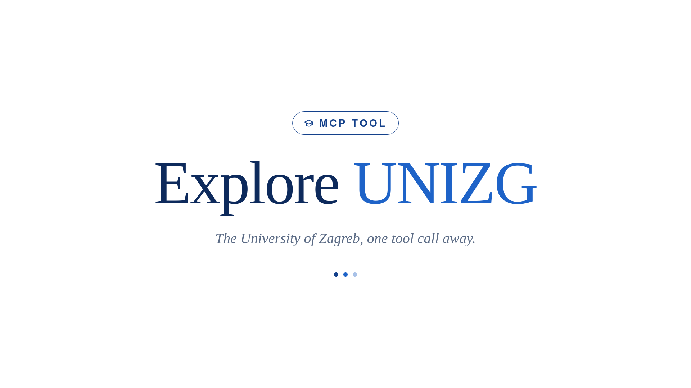

# explore_unizg

Two tools for planning studies at the University of Zagreb.

1. **Raspored kolegija**, a web app that turns a list of courses into a prerequisite graph and works
   out the earliest you could finish them.
2. **A course catalog server for Claude**, which answers what any UNIZG course covers, its ECTS, its
   literature and its prerequisites, straight from the official ISVU catalog. It can also hand you a
   study programme as JSON that you paste into the web app.

Stdlib Python and vanilla JS. No dependencies, no build step.

## 1. The web app

Run it:

```bash
python3 -m http.server 8000     # then open http://localhost:8000/
```

The default list is Molekularna biologija at PMF. Edit it, or replace it with any programme.

**Reading the graph.** One column per semester, grouped into years. An arrow means *prerequisite to
course*. A course sits in the first semester that is both after all its prerequisites and in its own
season, since zimski courses are only taught in odd semesters and ljetni in even ones. Hover a card to
light up everything upstream of it.

**Editing.** Click a course to set its name, semester, year, ECTS, whether it is obavezni or izborni,
and its prerequisites as `položen` or `odslušan`. Everything recomputes as you type. Courses with no
prerequisites can be dragged to a later semester of the same season if you want to push them back.

**The schedule.** `NAJRANIJE` is the earliest semester a course can be taken, `PLAN` is where the
official programme puts it, and a red arrow is the difference. The bars are ECTS load per semester.

**Buttons.** `Izvezi` saves your list as JSON, `Uvezi` loads one, `Zalijepi JSON` accepts pasted JSON,
`Vrati zadano` starts over. Your list is kept in the browser, so it survives a reload.

## 2. The catalog server for Claude

**Claude web and mobile.** Settings, Connectors, Add custom connector, and paste:

```
https://horizontal-mobility.vercel.app/api/mcp
```

**Claude Desktop or Claude Code.** Run it locally instead, nothing to deploy:

```json
{
  "mcpServers": {
    "unizg-courses": {
      "command": "python3",
      "args": ["/absolute/path/to/explore_unizg/mcp/stdio_server.py"]
    }
  }
}
```

Then just ask in plain language. You never name a tool yourself, Claude picks one, but it helps to
know what is actually in there.

### The tools

Nine tools. Shared conventions:

- **The faculty can be given as an id or as a name.** `36`, `FER`, `fakultet elektrotehnike` all work,
  and so do the other abbreviations people actually use (PMF, FSB, FFZG, FKIT, Arhitektonski). Ask
  `unizg_institutions` if you want the id.
- **Course and programme lookups accept a year**, as the starting year: `2026` means 2026/2027.
  Omit it for the current academic year, rolling over on October 1. An unavailable requested year
  is not silently replaced by another one. Institution/source directories and mobility rules do
  not take a year.
- **PMF searches cover both divisions.** A single-course or single-programme lookup needs the
  explicit ID, 37 or 119. Ambiguity is reported rather than silently choosing natural sciences.

---

#### `unizg_institutions` — which faculties exist

The live UNIZG institution list, including the central university catalog, with ISVU ids and cities.
Counts are not hard-coded. Filter by a name fragment. PMF has two separate IDs, 37 and 119.

#### `unizg_courses` — find a course by name

Searches course names at one faculty, or **across all discovered UNIZG entities if you leave the faculty out**. That
second mode takes about fifteen seconds and is the honest way to answer *where else is this taught*.

Search ignores diacritics, so `racunarstvo` finds `Računarstvo`. What comes back is a list of names
with their šifre, which is what the next tool needs. If more courses matched than fit in the answer,
the result says how many there were in total and how they were spread across faculties, so you get
told when you are looking at a slice rather than everything.

> *Which UNIZG faculties teach molecular biology?*

#### `unizg_course` — everything about one course

The detail page for a single course, which is where most of the interesting material is:

- **Opis predmeta**, the syllabus, and the learning outcomes where they exist (they are prose inside
  the description, not a separate field).
- **Literatura**, split into required and recommended.
- **ECTS and opterećenje**, the hours per activity type. Hours per ECTS is computable from this, and
  nobody else publishes it.
- **Preduvjeti**, both for enrolling in the course and for sitting its exam, as `položen` or
  `odslušan`.
- **Every programme the course belongs to**, with its semester and whether it is obavezni or izborni
  in each. One course can legitimately sit at different semesters in different programmes, so this
  is a list and not a single value.

> *What does Kvantna fizika at PMF cover, and what is the reading list?*

By default, supported FER and FOI course pages add verified `ishodi_ucenja`, missing descriptions,
and source metadata. Recommended background (`preporuceno_predznanje`) is kept separate from formal
enrollment/exam prerequisites. Course identity and displayed year must match. Source failures leave
the ISVU record intact with warnings. Pass `enrich: false` for an ISVU-only response.

#### `unizg_sources`: where to look beyond ISVU

Returns verified entry points for faculty course pages, learning-outcome PDFs, English-offering
lists, mobility documents, academic calendars, and timetables. Filter by faculty and optionally
`kind`; the response lists available kinds. Each route states its coverage, year handling, and
verification date. Unmapped institutions remain explicit, not silently described as publishing
nothing. A document link is not a claim that every PDF or timetable event has been extracted.

#### `unizg_discover`: topics inside syllabi

Searches titles, descriptions, and available learning outcomes, not teacher identities. This is
bounded live discovery, **not an exhaustive university-wide index**. It does not automatically
translate English queries into Croatian. Use the language of the source and narrow candidates:

```json
{"faculty":"FER","query":"grupiranje","candidate_query":"strojno","year":2026,"max_courses":12}
```

`candidate_query` filters titles before fetching details; `query` searches the fetched content.
`max_courses` defaults to 30 and is capped at 100. Results report candidates, examined records,
failures, missing filter values, and truncation. Optional filters are `ects_min`, `ects_max`,
`semester`, `status`, and `language`. Semester/status must match the same programme placement.
Missing language stays unknown; use official English-course lists from `unizg_sources` as well.

#### `unizg_programmes` — what a faculty offers

The programme and module tree for a faculty: prijediplomski, diplomski, doktorski and specialist
programmes, their delivery modes, and the ids the last two tools need. Parent nodes in the tree often
have no curriculum of their own, and the result marks which entries can actually be opened.

> *What can you study at Arhitektonski?*

#### `unizg_curriculum` — one programme, semester by semester

A full nastavni program: the obavezni courses in each semester, plus each elective group with the
minimum ECTS you have to take from it. This is the view that shows you the shape of a degree, and it
should come out near 30 ECTS per semester.

> *Show me the Arhitektura i urbanizam programme semester by semester.*

#### `unizg_dag_json` — a programme as JSON for the web app

Exports courses in the schema the scheduler imports, so you can paste them straight into the app.

Two modes, and the difference matters. Give it a **`target`** course and you get that course plus
everything that feeds into it, transitively, which is normally five to twenty courses and a graph you
can read. Add `max_depth` to stop after a level or two. Leave `target` out and you get the entire
programme, which for a five year degree is around a hundred courses and a graph too dense to be
useful.

Two things it has to clean up on the way out, and it tells you when it did:

- **Duplicate course names.** A year-long course is often listed twice, once as a 0 ECTS placeholder
  and once as the credit-bearing row. The app keys its graph by name and would refuse the import, so
  those get merged, keeping the row with the credits and the union of their prerequisites.
- **Prerequisites pointing outside the programme.** They are free text and routinely name a course
  that has since been renamed or retired. Those edges get dropped, because one unresolvable name
  makes the app reject the whole import. It is reported, since it means the graph is genuinely
  missing something.

> *Give me the prerequisite chain for Klasična elektrodinamika at PMF fizika as scheduler JSON.*

#### `unizg_mobility_rules` — the rules for studying at a second faculty

The only tool here that touches no network: it returns the rules for **horizontalna mobilnost**, taking
individual courses at another UNIZG faculty while staying enrolled on your own programme, and how that
differs from `paralelni studij`.

It exists because the catalog cannot answer the question students actually ask. ISVU tells you what is
taught where; it says nothing about whether you are allowed to go there. Left to guess, models guessed
badly in both directions — smaller ones refused the question outright, larger ones affirmed it and then
invented the fee, the deadline and the recognition rule. So the rules are written down, with their
sources: the *Pravilnik o studiranju* article 32 and the University's *Smjernice za horizontalnu
mobilnost* of 19 November 2024.

The short version, which is the part worth knowing: **it is an established right, not a favour.** The
level has to match, the course must not be taught on your own programme, and that is nearly all of it.
There is no grade-average requirement. Failing a course you took this way costs you nothing at home. What
genuinely varies per faculty is only the form, the fee, the deadline and whether the course has room.

> *Can I take molecular biology courses at PMF while I study at FER?*

### Getting a programme into the web app

Ask for a course and what leads to it, for example *"give me the prerequisite chain for Klasična
elektrodinamika at PMF fizika as scheduler JSON"*. Claude returns a JSON block. Open the app, click
**Zalijepi JSON**, paste it, confirm.

Asking for one course and its chain is usually what you actually want. A whole programme imports fine,
it is just unreadable.

## Where the data comes from

The [ISVU public catalog](https://www.isvu.hr/visokaucilista/hr/pocetna), the official system SRCE runs
for the ministry. Institutions are discovered live, including the central university's own courses.
The July 2026 sample counted roughly 27,400 records for 2025/2026; that is not a current coverage
promise. Data is fetched live with a local cache, not bundled as a complete dataset.

Coverage is uneven because it is only as complete as each faculty made it. Semester and ECTS are almost
always there. Descriptions cover under half of courses, learning outcomes a third, prerequisites about
one in ten in the historical ISVU sample. **An empty field means this source returned no value, not
that the faculty publishes nothing or the course lacks the thing.** FER and FOI course pages can add
verified detail. `unizg_sources` identifies further official documents and lists. Historical
per-faculty figures remain in [`skills/unizg-courses/references/institutions.md`](skills/unizg-courses/references/institutions.md).

The tools answer questions about teaching, not about people. Teacher names appear on course pages
because the faculties publish them there, but there is deliberately no way to search or rank by
professor.

### Horizontalna mobilnost, and which half comes from where

Searching every faculty at once answers what exists elsewhere and what you would be signing up for.
The rules are not in ISVU at all — they come from `unizg_mobility_rules`, which carries the
university-wide position and its sources, written up at
[`skills/unizg-courses/references/horizontalna-mobilnost.md`](skills/unizg-courses/references/horizontalna-mobilnost.md).

What is left for the student to ask their referada is narrow and worth stating precisely: the form, the
fee, the deadline, and whether the course has room. Not whether cross-faculty study is permitted, and
not what average they need. Most faculties publish none of this online — the University's own 2024 audit
of every constituent's website says so — but a missing page is a fact about that website, not about the
student's rights.

## Verification and publishing

Offline tests use public tool/module contracts with network fixtures. Live checks use the real
HTTP handler and official sources, without importing implementation details into the verifier:

```bash
python3 -m unittest discover -s api -p 'test_*.py' -v
python3 mcp/http_server.py 8901
# In another terminal:
python3 scripts/verify_discovery.py --endpoint http://127.0.0.1:8901/api/mcp
python3 scripts/verify_discovery.py --endpoint https://horizontal-mobility.vercel.app/api/mcp
```

Use `--only tools,central,pmf` for targeted checks. Live checks are upstream-dependent and expose
failures rather than declaring complete coverage. Fixture success does not replace a live run.
Production follows the repository's `main` branch through the existing Vercel integration. Verify
the GitHub deployment status and run the HTTP checks again after publishing.

## Also in here

- [`skills/unizg-courses/`](skills/unizg-courses/): agent guidance and official source routes, plus
  `scripts/isvu.py`, an ISVU-only standalone CLI. Automatic faculty enrichment and bounded content
  discovery are MCP features. `SKILL.md` documents retrieval order, endpoints and parsing traps.
- [`kolegiji_dag/`](kolegiji_dag/): a Python version of the scheduler, used to check the browser one.
- [`docs/unizg-catalog-plan.md`](docs/unizg-catalog-plan.md): how the catalog was mapped, with measured
  coverage per faculty.
- Tag [`v0-faculty-graph-app`](https://github.com/pitfa19/explore_unizg/tree/v0-faculty-graph-app): the
  earlier version of this project, a Django and Next.js app that clustered faculties by embedding
  similarity. It shares no code with what is here now.

## License

[MIT](LICENSE). Use it, fork it, ship it. If you build on it in published work, a citation is
appreciated: see [CITATION.cff](CITATION.cff), or GitHub's **Cite this repository** button.

Two things the license does not cover. The **course data** belongs to the University of Zagreb and its
faculties; this repository only queries what they already publish and ships no dataset of it. And the
**archived app** at tag `v0-faculty-graph-app` is our hackathon solution (we didn't win...)
