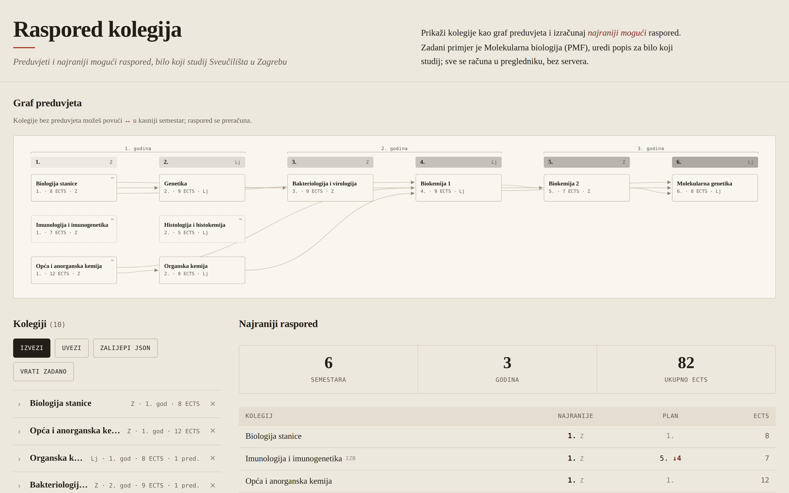
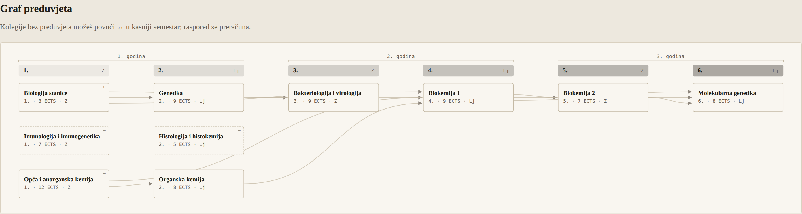
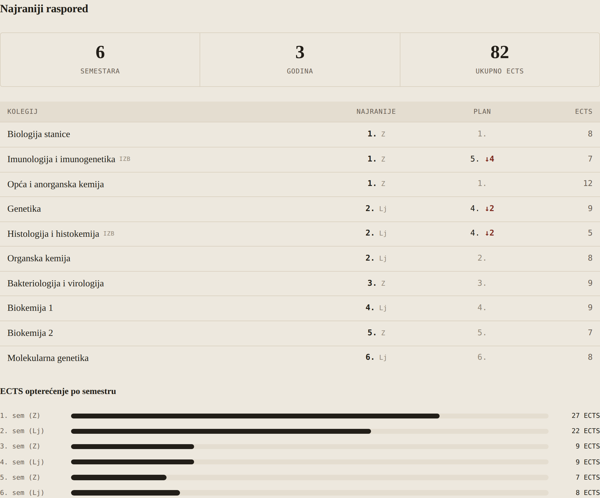
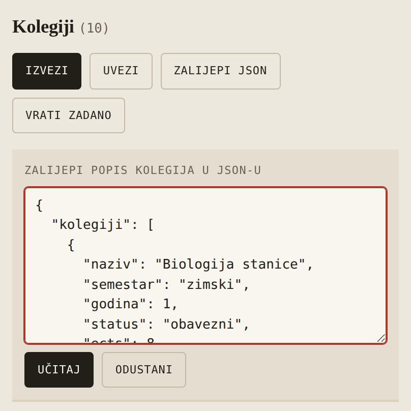

# explore_unizg

Two tools for planning studies at the University of Zagreb.

1. **Raspored kolegija**, a web app that turns a list of courses into a prerequisite graph and works
   out the earliest you could finish them.
2. **A course catalog server for Claude**, which answers what any UNIZG course covers, its ECTS, its
   literature and its prerequisites, straight from the official ISVU catalog. It can also hand you a
   study programme as JSON that you paste into the web app.

Stdlib Python and vanilla JS. No dependencies, no build step.



## 1. The web app

Run it:

```bash
python3 -m http.server 8000     # then open http://localhost:8000/
```

The default list is Molekularna biologija at PMF. Edit it, or replace it with any programme.

**Reading the graph.** One column per semester, grouped into years. An arrow means *prerequisite to
course*. A course sits in the first semester that is both after all its prerequisites and in its own
season, since zimski courses are only taught in odd semesters and ljetni in even ones. Hover a card to
light up everything upstream of it.



**Editing.** Click a course to set its name, semester, year, ECTS, whether it is obavezni or izborni,
and its prerequisites as `položen` or `odslušan`. Everything recomputes as you type. Courses with no
prerequisites can be dragged to a later semester of the same season if you want to push them back.

**The schedule.** `NAJRANIJE` is the earliest semester a course can be taken, `PLAN` is where the
official programme puts it, and a red arrow is the difference. The bars are ECTS load per semester.



**Buttons.** `Izvezi` saves your list as JSON, `Uvezi` loads one, `Zalijepi JSON` accepts pasted JSON,
`Vrati zadano` starts over. Your list is kept in the browser, so it survives a reload.

## 2. The catalog server for Claude

**Claude web and mobile.** Settings, Connectors, Add custom connector, and paste:

```
https://horizontal-mobility.vercel.app/api/mcp
```

**Claude Desktop or Claude Code.** Run it locally instead, nothing to deploy:

```json
{
  "mcpServers": {
    "unizg-courses": {
      "command": "python3",
      "args": ["/absolute/path/to/explore_unizg/mcp/stdio_server.py"]
    }
  }
}
```

Then ask in plain language. Things it can answer:

- *What does Kvantna fizika at PMF cover, and what is the reading list?*
- *Which UNIZG faculties teach molecular biology?* It searches all 37 constituents at once.
- *Show me the Arhitektura i urbanizam programme semester by semester.*
- *What do I need before Klasična elektrodinamika?*

Search ignores diacritics, so `racunarstvo` finds `Računarstvo`.

### Getting a programme into the web app

Ask for a course and what leads to it, for example *"give me the prerequisite chain for Klasična
elektrodinamika at PMF fizika as scheduler JSON"*. Claude returns a JSON block. Open the app, click
**Zalijepi JSON**, paste it, confirm.



Ask for a whole programme and you get all of it, which for a five year programme is around 100 courses
and a graph too dense to read. Asking for one course and its chain is usually what you actually want.

## Where the data comes from

The [ISVU public catalog](https://www.isvu.hr/visokaucilista/hr/pocetna), the official system SRCE runs
for the ministry: 37 faculties, about 27,400 courses, years back to 1976/77. It is read live, nothing is
cached in this repository.

Coverage is uneven because it is only as complete as each faculty made it. Semester and ECTS are almost
always there. Descriptions cover under half of courses, learning outcomes a third, prerequisites about
one in ten. **An empty field means the faculty published nothing, not that the course lacks the thing.**
Per-faculty figures are in [`skills/unizg-courses/references/institutions.md`](skills/unizg-courses/references/institutions.md).

The tools answer questions about teaching, not about people. Teacher names appear on course pages
because the faculties publish them there, but there is deliberately no way to search or rank by
professor.

## Also in here

- [`skills/unizg-courses/`](skills/unizg-courses/): the same capability as an Agent Skill, plus
  `scripts/isvu.py` which works as a standalone CLI. `SKILL.md` documents the endpoints and the parsing
  traps.
- [`kolegiji_dag/`](kolegiji_dag/): a Python version of the scheduler, used to check the browser one.
- [`docs/unizg-catalog-plan.md`](docs/unizg-catalog-plan.md): how the catalog was mapped, with measured
  coverage per faculty.
- Tag [`v0-faculty-graph-app`](https://github.com/pitfa19/explore_unizg/tree/v0-faculty-graph-app): the
  earlier version of this project, a Django and Next.js app that clustered faculties by embedding
  similarity. It shares no code with what is here now.

## License

[MIT](LICENSE). Use it, fork it, ship it. If you build on it in published work, a citation is
appreciated: see [CITATION.cff](CITATION.cff), or GitHub's **Cite this repository** button.

Two things the license does not cover. The **course data** belongs to the University of Zagreb and its
faculties; this repository only queries what they already publish and ships no dataset of it. And the
**archived app** at tag `v0-faculty-graph-app` has other authors, so licensing that would need their
agreement.
